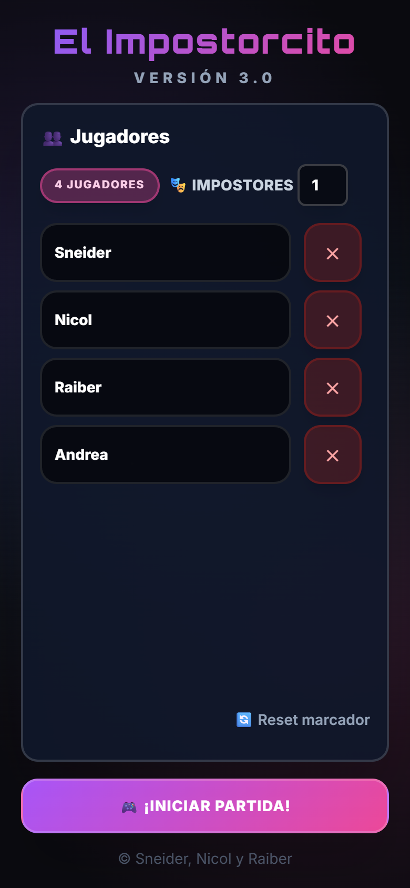
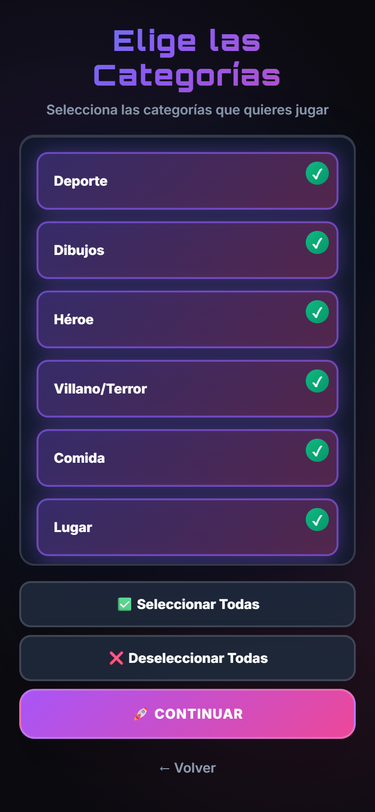
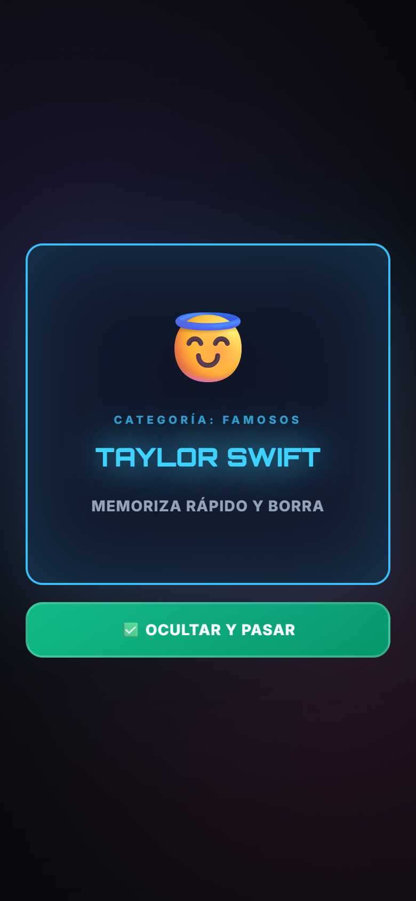
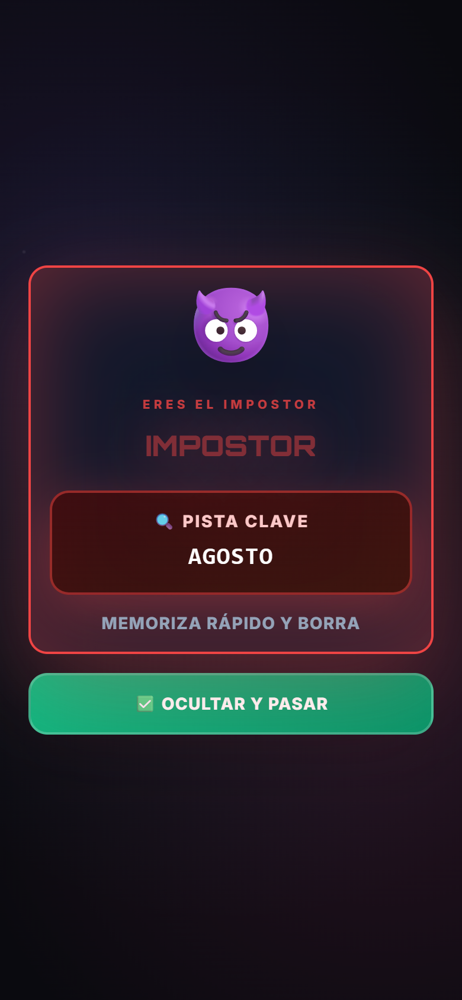
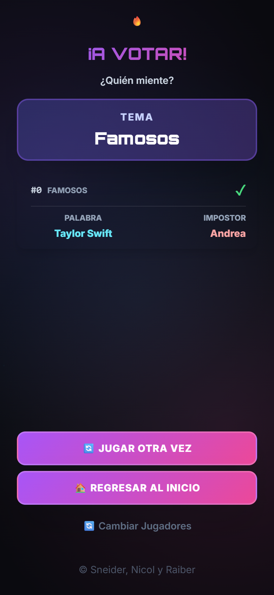

<div align="center">

# 🕵️ El Impostorcito

**Juego de deducción social para jugar en grupo con un solo teléfono.**
Todos conocen la palabra secreta… menos el impostor.

[](https://impostorcito.vercel.app/)

&nbsp;
&nbsp;
&nbsp;


`v3.0` · 252 palabras · 12 categorías · 3+ jugadores

</div>

---

## Vista previa

<div align="center">
  &nbsp;
  &nbsp;
  &nbsp;
  &nbsp;
  
  <br />
  <sub>Jugadores · Categorías · Inocente · Impostor · Votación</sub>
</div>

---

## ¿Cómo se juega?

1. **Anoten a los jugadores** (mínimo 3) y elijan cuántos impostores habrá.
2. **Escojan las categorías** con las que quieren jugar.
3. **Pásense el teléfono.** Cada jugador ve su carta en privado:
   - los **inocentes** ven la **palabra secreta**;
   - el **impostor** solo ve una **pista** relacionada.
4. **Hablen.** Cada uno dice algo sobre la palabra sin regalarla. El impostor tiene que disimular y deducir de qué se habla.
5. **Voten** quién creen que es el impostor.
6. **Resultado:** si el impostor se salva, suma **+1 punto**. Si lo descubren, nadie suma.

> 💡 El reto para los inocentes es dar pistas lo bastante claras para reconocerse entre ellos, pero no tanto como para que el impostor adivine la palabra.

---

## Características

| | |
|---|---|
| 🎭 **Varios impostores** | Configurable. Con 2 o más, cada impostor recibe una pista **distinta**, así no pueden coordinarse. |
| 🗂️ **Filtro de categorías** | Activa solo los temas que conoce tu grupo. Todas vienen seleccionadas por defecto. |
| 🔁 **Sin palabras repetidas** | Ninguna palabra sale dos veces hasta agotar las disponibles. |
| 🏆 **Marcador** | Puntos acumulados por jugador entre rondas. |
| 📜 **Historial** | Cada ronda guarda palabra, categoría, impostor(es) y resultado (✓ / ✗), paginado de 3 en 3. |
| 📱 **Mobile first** | Pensado para pasar un solo teléfono de mano en mano. |

---

## Categorías

| Categoría | Palabras | | Categoría | Palabras |
|---|:---:|---|---|:---:|
| ⭐ Famosos | 46 | | 🦸 Héroes | 16 |
| 🍔 Comida | 26 | | 🏛️ Arquitectura | 16 |
| 🏠 Tech/Casa | 22 | | 🇻🇪 Venezuela | 16 |
| ⚽ Deporte | 21 | | 💻 Ing. Sistemas | 15 |
| 🎨 Dibujos | 20 | | 😈 Villano/Terror | 14 |
| 🗺️ Lugar | 20 | | ⚕️ Medicina | 20 |

Cada palabra tiene **dos pistas** relacionadas, pero no obvias. Por ejemplo, *Fútbol* → "Once", "Balón".

---

## Ejecutar en local

No necesita instalación ni build. Clona el repo y abre `index.html` en el navegador:

```bash
git clone https://github.com/Sneider22/impostorcito.git
```

### Estructura

```
impostorcito/
├── index.html      # Pantallas del juego
├── css/style.css   # Estilos y animaciones
└── js/script.js    # Base de palabras y lógica de partida
```

¿Quieres agregar palabras? Edita el arreglo `database` al inicio de `js/script.js`:

```js
{ cat: "Deporte", word: "Fútbol", hints: ["Once", "Balón"] }
```

---

<div align="center">

Sneider Araque

</div>
